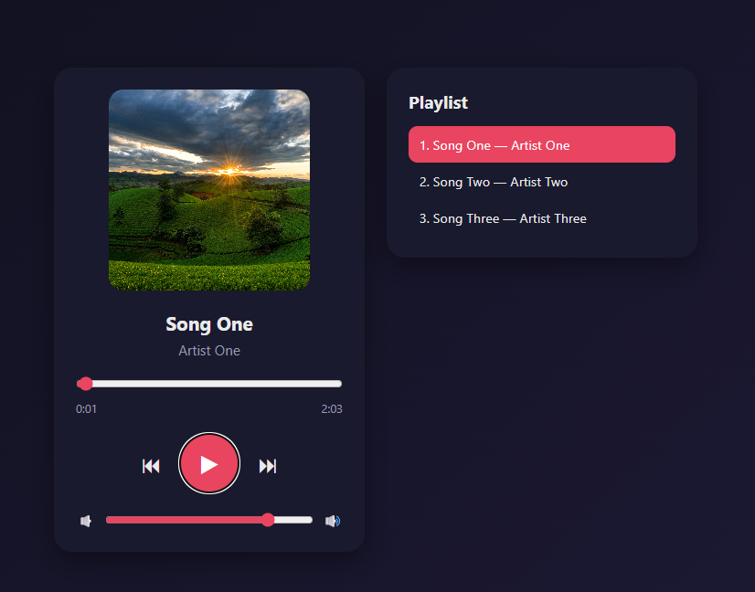

# 🎵 CodeAlpha_MusicPlayer

A responsive music player built with HTML, CSS and vanilla JavaScript. This project was completed as part of the **CodeAlpha Frontend Development Internship**.

## ✨ Features

- ▶️ Play / Pause
- ⏮️ Previous / ⏭️ Next song navigation
- 📊 Progress bar with seek support (click or drag to jump to any position)
- ⏱️ Current time and total duration display
- 🔊 Volume control
- 🎼 Playlist with click-to-play and active song highlight
- 🔁 Autoplay (next song plays automatically when the current one ends)
- 🖼️ Album cover display
- 📱 Responsive layout for desktop and mobile

## 🛠️ Technologies Used

- **HTML5** — structure and `<audio>` element
- **CSS3** — Flexbox layout, transitions, hover effects and media queries
- **JavaScript (ES6)** — audio control, DOM manipulation and event handling

## 📁 Project Structure
CodeAlpha_MusicPlayer/
├── index.html # Main page structure
├── css/
│ └── style.css # Styling and responsive design
├── js/
│ └── script.js # Player logic and event handling
├── assets/
│ ├── covers/ # Album cover images
│ └── songs/ # Audio files (mp3)
└── README.md

